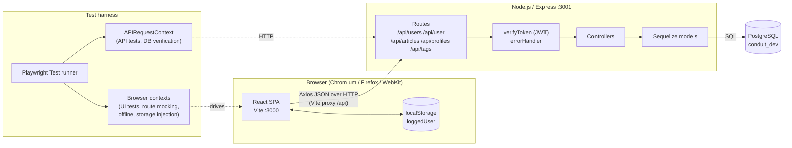

# Application Architecture & Test Strategy

## 1. Application under test
**Conduit** (RealWorld example app) — a Medium-style blogging platform.
Source: https://github.com/TonyMckes/conduit-realworld-example-app (MIT licence).

| Layer | Technology | Responsibility |
|---|---|---|
| Web UI | React 19 + React Router 7 (HashRouter), Vite dev server on **:3000** | Pages: Home, Login, Register, Settings, Editor, Article, Profile. Session kept in `localStorage["loggedUser"]` and React `AuthContext`. |
| HTTP client | Axios (`frontend/src/services/*`) | Calls `/api/*`; Vite proxies `/api` to the backend. |
| Application server | Node.js + Express 5 on **:3001** | REST API (`/api/users`, `/api/user`, `/api/articles`, `/api/profiles`, `/api/tags`). |
| Auth | JWT (`jsonwebtoken`) + bcrypt password hashing | `verifyToken` middleware reads `Authorization: Token <jwt>`. |
| Data access | Sequelize 6 ORM | Models: User, Article, Comment, Tag; join tables Favorites, Followers, TagList. |
| Database | **PostgreSQL 18** | Persistent storage. |

Data flow for a typical write (e.g. *publish article*):
UI form → Axios `POST /api/articles` with `Authorization: Token …` → `verifyToken` decodes the JWT and loads the user → controller validates fields → Sequelize `INSERT` into `Articles`/`TagList` → `201` JSON → UI navigates to `/article/:slug`.

## 2. Testing problems considered
1. **End-to-end critical workflows touching the database.** These cover registration, login, logout, and creating, editing and deleting articles, plus comments, profile updates, favourites and follows. Every positive test reads the record back through the API, which proves the database was updated, not just that the UI changed.
2. **Unauthorized access.** We send requests with no token, a forged token and a tampered token, and we try to edit or delete another user's article. We also check that protected pages and controls are hidden when there is no session.
3. **Form validation.** We test native HTML5 `required` checks, server-side validation when the client checks are bypassed, invalid emails, duplicate emails, and missing or whitespace-only fields.
4. **Network failures.** We abort requests, return mocked HTTP 500 responses, and set the browser context offline.
5. **Edge cases.** We send very long titles, Unicode and special characters, and script/HTML injection (XSS).
6. **Cross-browser behaviour.** Every test runs on Chromium, Firefox and WebKit (Safari engine).

## 3. Client-side testing technique used
Both techniques named in the brief are applied:

- **Session-data technique.** `injectSession()` writes a session object straight into `localStorage` via `page.addInitScript`, before any app code runs. It uses the same shape the app itself stores. With it we can:
  - log in instantly as any user;
  - inject *forged* or *tampered* tokens (TC07, TC20);
  - delete the session mid-use (TC19);
  - start with no session at all (TC18).
- **Bypass technique.** The client-side checks are switched off: `page.evaluate()` removes the `required` attributes and sets `form.noValidate` (TC17), or the payload is sent directly with `APIRequestContext` (TC13, TC25, TC29). This tests whether the *server* enforces the rules.
- **Network-layer manipulation.** `page.route()` aborts or fulfils requests with mocked responses (TC09, TC24), and `context.setOffline(true)` simulates an offline client (TC26).

## 4. Choice of tool: Playwright
| Need | Why Playwright |
|---|---|
| Cross-browser | One API drives Chromium, Firefox and WebKit; configured as 3 projects in `playwright.config.js`. |
| Network failure simulation | Built-in `page.route()` (abort/fulfill) and `context.setOffline()`; no proxy needed. |
| Session manipulation | `addInitScript`, `page.evaluate`, isolated browser contexts per test. |
| API + DB verification in the same test | `request` fixture (`APIRequestContext`) replaces a separate Postman collection. |
| Reliability | Auto-waiting locators and web-first assertions (`toBeVisible`, `toHaveURL`) reduce flakiness. |
| Evidence for bug reports | Screenshot, video and trace captured automatically on failure; HTML, JSON and JUnit reporters. |
| App lifecycle | `webServer` option starts frontend + backend before the run. |

Selenium would need separate driver binaries and a proxy for network mocking. Cypress has limited WebKit support and cannot use several tabs or origins as freely. No AI agents or agentic test frameworks are used: all tests are hand-written Playwright Test scripts.

## 5. Browser compatibility
| Browser project | Engine | Device profile |
|---|---|---|
| chromium | Chromium (Chrome/Edge) | Desktop Chrome, 1280×720 |
| firefox | Gecko | Desktop Firefox, 1280×720 |
| webkit | WebKit (Safari) | Desktop Safari, 1280×720 |

See `docs/TEST_SUMMARY.md` for per-browser results.
